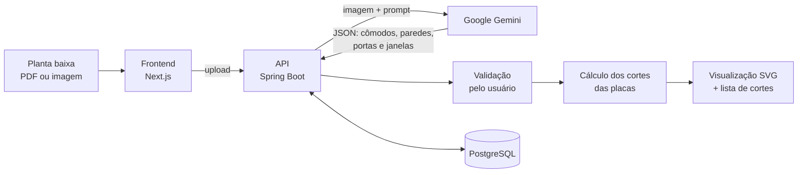

# Speed Formas AI

**Planta baixa entra, plano de corte sai.** Sistema que usa IA para ler plantas baixas e calcular automaticamente os cortes das placas de fôrma de uma obra.

> 🇺🇸 [English summary below](#english)

## O problema

Calcular os cortes das placas de fôrma de uma obra é trabalho manual: medir cada parede na planta, descontar portas e janelas e montar o plano de corte placa por placa. É lento e um erro de medida vira desperdício de material.

## Como funciona



1. **Leitura da planta com IA:** o Gemini recebe a planta e devolve um JSON estruturado com cômodos, paredes, portas e janelas, já convertidos para metros.
2. **Validação humana:** uma tela intermediária mostra o que a IA extraiu. O usuário corrige ou completa as medidas antes do cálculo, assim um erro de leitura não chega à obra.
3. **Cálculo dos cortes:** para cada parede, o sistema distribui as placas e desconta os vãos de portas e janelas.
4. **Visualização:** o backend gera desenhos SVG dos cortes de cada parede, e o frontend também lê arquivos DXF e PDF.

Também tem login, perfis de acesso, parâmetros do sistema construtivo e biblioteca de projetos.

## Stack

| Camada | Tecnologias |
|---|---|
| Frontend | Next.js 16, React 19, TypeScript, Tailwind CSS 4, shadcn/ui, react-hook-form + zod, pdf.js, dxf-parser |
| Backend | Java 21, Spring Boot 3.5, Spring Data JPA, OpenAPI/Swagger |
| IA | Google Gemini (visão + saída em JSON), workflow opcional no Dify |
| Dados | PostgreSQL 15 (Docker) |

## Rodando localmente

Pré-requisitos: Docker, Java 21, Node.js 20+ e uma chave da API do Gemini.

```bash
# 1. Banco de dados (cria um usuário de demonstração local: admin / admin123)
docker compose up -d

# 2. API: http://localhost:8085 (Swagger em /swagger-ui.html)
cd backend/user
GEMINI_API_KEY=sua-chave ./mvnw spring-boot:run

# 3. Frontend: http://localhost:3000
cd frontend
cp .env.example .env.local
npm install
npm run dev
```

Variáveis do backend: `GEMINI_API_KEY` (obrigatória), `DB_URL`, `DB_USER`, `DB_PASSWORD` (padrão: Postgres local do Docker).

## Próximos passos

- Hash de senhas com BCrypt
- Mover a chamada ao Dify para uma rota de servidor, sem chave no navegador
- Testes automatizados do cálculo de cortes

## Autoria

Desenvolvido por [Davi Coutinho](https://github.com/DavesCP) em parceria com Diego Fernando da Silva.

---

## English

**Floor plan in, cutting plan out.** Speed Formas AI reads architectural floor plans with Google Gemini, extracts rooms, walls, doors and windows as structured JSON, lets the user review the extraction, then computes how each formwork panel must be cut for every wall, rendered as SVG drawings.

**Stack:** Next.js 16 · React 19 · TypeScript · Tailwind CSS · Java 21 · Spring Boot 3.5 · PostgreSQL · Google Gemini · Dify.

See *Rodando localmente* above for setup. The commands are the same in any language.
